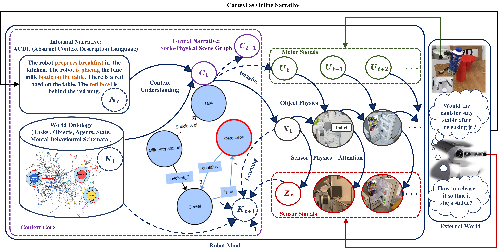
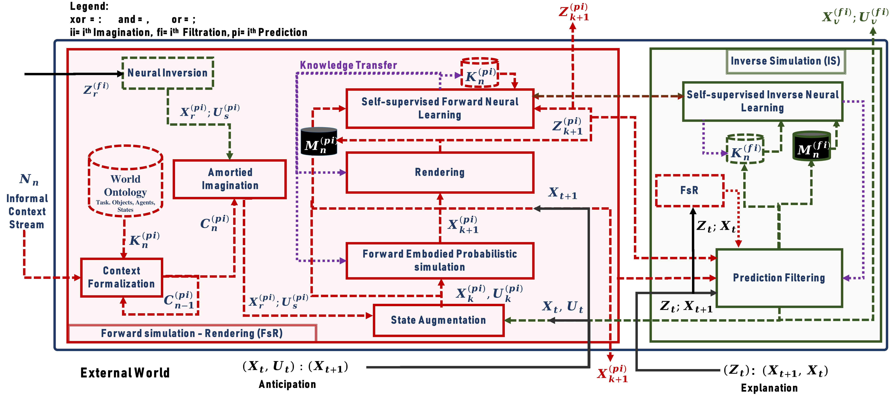
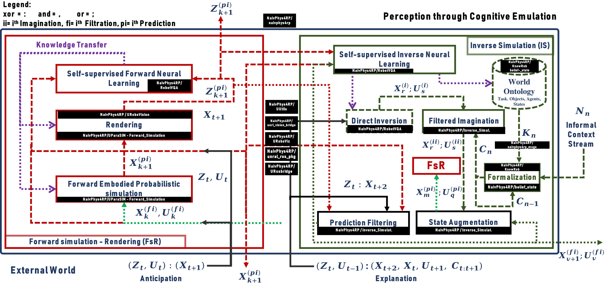

# naivphys4rp
Perception as [inner realistic world construction](https://github.com/NaivPhys4RP/belief_state/) that [anticipates](https://github.com/NaivPhys4RP/forward_simulation_rendering/) and [explains](https://github.com/NaivPhys4RP/inverse_simulation/) the world state as well as observations in an explainable manner, with reasonable computational resources. NaivPhys4RP is a white-box and causal generative model of perception [(See paper)](http://dx.doi.org/10.1109/Humanoids53995.2022.10000153).

The principle is illustrated by the figure below:

</img>

NaivPhys4RP is the designed perception system architecture that realizes this principle:

</img>

For more details on the distribution of packages (in black background and white foreground) in this architecture is as follows:

</img>

The scientific publications related to this work are:

## Scientific Results

### Category A – Articles in peer-reviewed journals, contributions to peer-reviewed conferences or to anthology volumes, and book publications

1. Kenghagho Kenfack, Franklin: *Prospective Perception through Cognitive Emulation for Robot Manipulation Tasks: “Perceiving like Humans Do”*. Doctoral Dissertation, 2025, University of Bremen. DOI: 10.26092/elib/4781.

2. Kenghagho Kenfack, Franklin; Ahmed Siddiky, Feroz; Balint-Benczedi, Ferenc; Beetz, Michael: *RobotVQA — A Scene-Graph- and Deep-Learning-based Visual Question Answering System for Robot Manipulation*. In: 2020 IEEE/RSJ International Conference on Intelligent Robots and Systems (IROS), 2020, pp. 9667–9674. DOI: 10.1109/IROS45743.2020.9341186.

3. Kenghagho Kenfack, Franklin; Neumann, Michael; Mania, Patrick; Tan, Toni; Siddiky, Feroz Ahmed; Weller, René; Zachmann, Gabriel; Beetz, Michael: *NaivPhys4RP — Towards Human-like Robot Perception “Physical Reasoning based on Embodied Probabilistic Simulation”*. In: 2022 IEEE-RAS 21st International Conference on Humanoid Robots (Humanoids), 2022, pp. 815–822. DOI: 10.1109/Humanoids53995.2022.10000153.

4. Kenghagho Kenfack, Franklin; Neumann, Michael; Mania, Patrick; Beetz, Michael: *Perception through Cognitive Emulation: “A Second Iteration of NaivPhys4RP for Learningless and Safe Recognition and 6D-Pose Estimation of (Transparent) Objects”*. In: 2024 IEEE International Conference on Robotics and Automation (ICRA), 2024, pp. 7679–7685. DOI: 10.1109/ICRA57147.2024.10610037.

5. Mania, Patrick; Kenghagho Kenfack, Franklin; Neumann, Michael; Beetz, Michael: *Imagination-enabled Robot Perception*. In: 2021 IEEE/RSJ International Conference on Intelligent Robots and Systems (IROS), 2021, pp. 936–943. DOI: 10.1109/IROS51168.2021.9636359. Best Cognitive Robotics Paper Award.

6. Kazhoyan, Gayane; Stelter, Simon; Kenghagho Kenfack, Franklin; Koralewski, Sebastian; Beetz, Michael: *The Robot Household Marathon Experiment*. In: 2021 IEEE International Conference on Robotics and Automation (ICRA), 2021, pp. 9382–9388. DOI: 10.1109/ICRA48506.2021.9560774.

7. Alt, Benjamin; Picklum, Mareike; Arion, Sorin; Kenghagho Kenfack, Franklin; Beetz, Michael: *Open, Reproducible and Trustworthy Robot-Based Experiments with Virtual Labs and Digital-Twin-Based Execution Tracing*. In: 1st IROS Workshop on Embodied AI and Robotics for Future Scientific Discovery (AIR4S), 2025. DOI: 10.48550/arXiv.2508.11406. Winner of the Best Poster Award.

8. Mania, Patrick; Neumann, Michael; Kenghagho Kenfack, Franklin; Beetz, Michael: *Towards Autonomous Verification: Integrating Cognitive AI and Semantic Digital Twins in Medical Robotics*. In: 2025 IEEE International Conference on Robotics and Automation (ICRA), 2025, pp. 1736–1742. DOI: 10.1109/ICRA55743.2025.11127803.

9. Alt, Benjamin; Kenghagho Kenfack, Franklin; Haidu, Andrei; Katic, Darko; Jäkel, Rainer; Beetz, Michael: *Knowledge-driven robot program synthesis from human VR demonstrations*. In: Proceedings of the 20th International Conference on Principles of Knowledge Representation and Reasoning (KR '23), 2023, Article No. 4, pp. 1–10. DOI: 10.24963/kr.2023/4.

10. Meißenhelter, Hermann; Kenghagho Kenfack, Franklin; Weller, René; Zachmann, Gabriel: *Exploring Approaches for Rigid Body Dynamics with Uncertainty*. In: Proceedings of the 34th International Conference on Computer Graphics, Visualization and Computer Vision (WSCG 2026), 2026.
