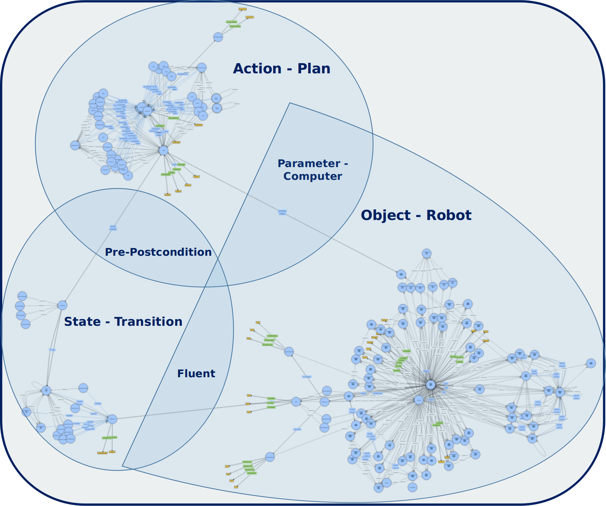

# 1. traceBot-knowRob

This project is dedicated to symbolic knowledge representation and reasoning in the TraceBot project. This results from a systematic formalization of the TraceBot use case description achieved over the project's first year. Contentwise, the medical cell is made up of objects, which can be manipulated (e.g., canister) or processors (e.g., robot arm). A state of the world is a set of is a set of fluents. A fluent is a temporal predicate about some objects and can change its value between true and false over time, depending on whether the predicate holds at that particular time (e.g., at(canister, table)). An action has some parameters, where a parameter is either an Object or Attribute with a specific integer position in the parameter list of the action. An action can trigger some instructions where an instruction implements an action, has an integer index in the list of the triggering action’s instruction list, and has a parameter switch component, which is a map between the parameters of the calling action and the called action. A transition is the transformation of a world state via an action to another world state. An action is associated to a transition that links the action’s precondition as required state and the action’s postcondition as expected state.  Finally, an action is computed by some processors. The figure below presents an overview of the ontology.

<p align=center>
</img>
</p>

---
For a stable and recent version, we recommend the master branch. Other branches are subject to development and instability.

---

# 2. Prerequisites

- ROS (*ROS noetic* for the master branch)
- SWI Prolog >= 8.2.4 (see [Further Information](https://github.com/artnie/knowrob/tree/update-setup#further-information))
- mongo DB server >= 4.4 and libmongoc (see [Further Information](https://github.com/artnie/knowrob/tree/update-setup#further-information))
- [catkin_virtualenv in your ROS workspace](https://github.com/locusrobotics/catkin_virtualenv) . You can clone it manually or use the rosinstall file from tracebot_process.

# 3. Installation

## 3.1. knowrob base 

KnowRob uses the [catkin](http://wiki.ros.org/catkin) buildsystem that has been the main ROS buildsystem.
We have prepared different *.rosinstall* setup files that you can add to your ROS workspace as described [here](http://www.ros.org/wiki/ROS/Tutorials/InstallingandConfiguringROSEnvironment). The path to knowrob base is [/path_to_knowrob_base](https://gitlab.com/tracebot/uob/knowrob.git).

```Bash
rosdep update
cd ~/catkin_ws/src
wstool init
wstool merge /path_to_knowrob/rosinstall/knowrob-base.rosinstall
wstool update
rosdep install --ignore-src --from-paths .
cd ~/catkin_ws
catkin_make
```
If the build fails during linking due to a missing swipl reference, please add the following lines to your ~/.bashrc:
```
export LD_LIBRARY_PATH=$LD_LIBRARY_PATH:/usr/lib/swi-prolog/lib/x86_64-linux/
export LIBRARY_PATH=$LIBRARY_PATH:/usr/lib/swi-prolog/lib/x86_64-linux/
```
After that, source the ~/.bashrc or start a new shell and then try building your workspace again.

You may further need to set the *SWI_HOME_DIR* environment variable to the installation location of *swipl*:

```
export SWI_HOME_DIR=/usr/lib/swi-prolog
```

## 3.1. tracebot-knowrob layer

```Bash
cd ~/catkin_ws/src
git clone https://gitlab.com/tracebot/uob/tracebot-knowrob.git

catkin build tracebot-knowrob
```

# 4. Launching

In order to launch the knowrob reasoning server,

```
roslaunch tracebot-knowrob tracebot-knowrob.launch with_kb_reset:=true
```

This will launch the knowrob base server node as well as the knowrob proxy server for tracebot. the parameter with_kb_reset indicates whether or not to reset the KB at startup (all NEEMs lost). By default, the parameter is true. Set this parameter to false if you want to keep old NEEMs. You can also reset the KB online with KBReset. But, you will need to load the ontologies again either by default with KBLoadDefaultOntology.action or explicitly with KBLoadOntology.action. If you want to load additional ontology, you can just call KBLoadOntology.action additionally. **To speed up the starting of knowRob, just set with_kb_reset to false when launching it.**

# 5. Symbolic reasoning with knowrob

We offer a very flexible ros interface for reasoning with knowrob. Moreover, the user can load his own knowledge base a.k.a. ontology and reason with knowrob based on it. Note also that the ros interfaces will be enriched on demand. **action calls have boolean feedbacks and results for calls with a false feedback should not be considered.** For more information about the inputs/outputs of action interfaces, please refer to tracebot_msgs/action.

## 5.1. Loading an ontology into the reasoning engine

This action is handeld by **KBLoadOntology.action** as follows for instance:

```Bash
rostopic pub /tracebot_knowrob_load/goal tracebot_msgs/KBLoadOntologyActionGoal "header:
  seq: 0
  stamp:
    secs: 0
    nsecs: 0
  frame_id: ''
goal_id:
  stamp:
    secs: 0
    nsecs: 0
  id: ''
goal:     
  package: 'tracebot-knowrob'							
  relative_path: 'ontology/TraceBotOntology.owl'
  namespace: 'http://www.semanticweb.org/smile/ontologies/2022/2/TraceBot#'"
```
It takes as input the ros package *(package)* where the ontology is located, the *relative path* to ontology from package root folder and the *ontology namespace* (to be found in the header of .owl). The call returns *status=true* if successful and *status=false* otherwise.

## 5.2. Extract concepts related to a particular concept

This action is handeld by **KBSubClass.action** as follows for instance:

```Bash
rostopic pub /tracebot_knowrob_subclass/goal tracebot_msgs/KBSubClassActionGoal "header:
  seq: 0
  stamp:
    secs: 0
    nsecs: 0
  frame_id: ''
goal_id:
  stamp:
    secs: 0
    nsecs: 0
  id: ''
goal:
  class_name: 'Container'
  is_sub: false" 
```
It takes as input a concept *(class_name)*, the type of parental relation *(is_sub=false if superclass and true if subclass)*. The call returns a list of concepts *classes[]* related to class_name through sub- or superclassing.

## 5.3. Extract common pose related to an object

This action is handeld by **KBCommonPose.action** as follows for instance:

```Bash
rostopic pub /tracebot_knowrob_common_pose/goal tracebot_msgs/KBCommonPoseActionGoal "header:
  seq: 0
  stamp:
    secs: 0
    nsecs: 0
  frame_id: ''
goal_id:
  stamp:
    secs: 0
    nsecs: 0
  id: ''
goal:
  class_name: 'Canister'
  pose_type: 'Grasp'" 
```
It takes as input a concept *(class_name)*, the type of pose *(e.g., Grasp for grasp pose, Insert for pose after insertion, Locate for actual pose, ...)*. The call returns a *geometry_msgs/Pose*.


## 5.4. Instantiate a concept (Creation of individuals) 

This action is handeld by **KBNewIndividual.action** as follows for instance:

```Bash
rostopic pub /tracebot_knowrob_individual/goal tracebot_msgs/KBNewIndividualActionGoal "header:
  seq: 0
  stamp:
    secs: 0
    nsecs: 0
  frame_id: ''
goal_id:
  stamp:
    secs: 0
    nsecs: 0
  id: ''
goal:
  class_name: 'Canister'" 
```
It takes as input a concept *(class_name)*, creates an instance of the concept in the ABOX and then returns a unique Id *(object_id)* of the created instance that then allows you to access the created individual later. Note that the ABOX is permanent and stored into a MongoDB.

## 5.5. Execute query in native knowrob language 

This action is universal and handeld by **KBQueryKnowledge.action** as follows for instance:

```Bash
rostopic pub /tracebot_knowrob_query_knowledge/goal tracebot_msgs/KBQueryKnowledgeActionGoal "header:
  seq: 0
  stamp:
    secs: 0
    nsecs: 0
  frame_id: ''
goal_id:
  stamp:
    secs: 0
    nsecs: 0
  id: ''
goal:
  query: 'kb_call((subclass_of(A, B))).'"
```
It takes as input a query in knowrob language *(query)*. The example query *"kb_call((subclass_of(A, B)))."* retrieves from the ontology all the concepts A,B such that A are subclasses of B. The call returns a *list of dictionary* where each dictionary represents an interpretation of the variables in query that satisfy query.

## 5.6. Execute a fake tracebot process while collecting NEEMs 

this action **KBQueryKnowledge.action** emulates a TB process  as follows for instance:

```Bash
rostopic pub //tracebot_knowrob_fake_process//goal tracebot_msgs/KBFakeTBProcessActionGoal "header:
  seq: 0
  stamp:
    secs: 0
    nsecs: 0
  frame_id: ''
goal_id:
  stamp:
    secs: 0
    nsecs: 0
  id: ''
goal:
  scenario_name: 'Insert Canister into drain tray'
  path_name: '/home/franklin/Desktop/Demos'"
```
It takes as input a short description of the experiment called *(scenario_name)* as well as the folder path where to store the subsymbolic NEEMs experiences as mongo db *(path_name)*. The example query executes the "insert canister into drain tray scenario". 

## 5.7. Generate an Audit Trail from previously executed process 

this action **KBAuditTrail** generate an audit trail pdf as follows for instance:

```Bash
rostopic pub /tracebot_knowrob_audit_trail/goal tracebot_msgs/KBAuditTrailActionGoal "header:
  seq: 0
  stamp:
    secs: 0
    nsecs: 0
  frame_id: ''
goal_id:
  stamp:
    secs: 0
    nsecs: 0
  id: ''
goal:
  path_name: '/home/franklin/Trail.pdf'"
```
It takes as input the location path where the audit trail is to be stored *(path_name)* and generate a human-understandable audit trail from the NEEMs previously collected or the process previously executed. An example of an preliminary version of the audit trail for the above scenario is at [Trail.pdf](images/AUDIT.pdf) 

## 5.8. How to record a NEEM from a process? 

In this section, we show how to record a neem from a process. The neem interface is an object with following key methods. Note that this interface will be subject to augmentation over time in order to add more information into the NEEM. The neem interface object is defined by the module [neem_interface](src/neem_interface). 

```Bash
1. Episode, RootAction=self.start_episode(RootActionType)
```
An episode is a coherent set of actions that target a goal that can be reached by a so called root action (the sum of all actions). The above function start an episode for a given root action specified by **RootActionType**. RootActionType is statically given in the target process or dynamically acquired through **KBGetClassId.action**. This method returns a unique ID of the started episode **Epidode** as well as a unique ID of the root action that the episode realizes **RootAction**.

```Bash
2. self.setEpisodeTitle(Episode,Title)
```
After starting an episode, this method sets the title **Title** of the episode instance returned in (1). **Title** is a basically a string-based text (e.g., Inserting needle into bottle septum).

```Bash
3. SubAction = self.begin_skill(ParentAction,ActionType)
```
Given a calling action with unique ID **ParentAction**, this method sets an action of type **ActionType** as a called subaction of the caller and returns the unique ID of the subaction as **SubAction**.

```Bash
4. self.end_skill(SubAction, result)
```
This method marks the end of an action execution with ID **SubAction** and verification status (True for successful and False for Failed) **result**.

```Bash
5. self.setActionVerificationConfidence(SubAction, confidence)
```
Beside the **result** in (4), this method sets the verification confidence of the **SubAction** to **confidence** (a float between 0 and 1.0). This confidence will be regarded as the probability of the verification's result during reasoning. Note also that verification methods such as is_successful and is_feasible return as result a couple (result:boolean, confidence:float). the sequence order between (4) and (5) can be switched.

```Bash
6. self.stop_episode(path_name)
```
This method stops the current started episode and exports the recorded NEEM to the folder specified by the path **path_name**. Note this export is not compulsory and can be neglected (e.g., empty path, ...).


## 5.9. Other interfaces for reasoning with knowrob 

For exploring the full library of action interfaces for reasoning with knowrob, please refer to tracebot_msgs/action.

# 6. Miscellaneaous

- For consulting the ontology and play around with it, it is enough to download the software Protege and load the ontology TracebotOntology.owl from folder ontology.

- To enable advanced reasoning based on SWRL rules, enable the Plugin SWRLTab and enable the tab SWRLTab

- You do also have the possibility to create a specific world (ABOX) and play around with inference tasks. Note that the ABOX is permanent and stored in a MongoDB. Note also that the interaxtions with MongoDB are encapsulated in the above action interfaces.

# 7. Verification Framework: RobAuditor

in this section, we present the internal working of RobAuditor from the recording of episodic memories of robot activities through the automated planning and execution of action verification tasks and audit trail generation to the self-recovery from failures. (1) As the process master turns action plans or skill sequences into motion, (2) the process tracer makes use of the query language presented above to build narrative-enabled episodic memories of the robot activities (NEEMs). (3) As the process tracer logs episodic memories, it also sends action verification queries (feasibility or success) to the verification executive through the NEEM interface, which queries are then processed by extracting the structure and context of the target action from NEEMs and generating a verification pipeline based on the verification-centric ontology of everyday activities TraceBot-SOMA presented earlier, which pipeline is then executed and the resulting output namely the decision (e.g., failed/succeeded), the confidence of the decision (empirical confirmation) and the explanation of the decision logged into NEEMs to enrich them. (4) Finally, the process tracer can also systematically or under request of the process master send an audit request through the NEEM interface to the verification framework which synthesizes the episodic memories into a concise document called audit trail, sent to the process master or end-user for either understanding what is going on and replan, continue, stop or to appreciate what the robot performed.

<p align=center>
</img>
</p>

At the core of this verification and audit automation is an efficient exploitation of SOMA (Socio-Physical Models of Activities) which represents observations of the world through physical models (e.g., objects, events such as actions), the agent interpretation of these observations through social models (e.g., computed tasks, object roles) and the principles of interpretation. This being said, it is possible to represent through NEEMs by instantiating SOMA the actions performed, the motions within the actions, the tasks executed by these performed actions, the entities participanting to these task executions, the roles these entities play in the execution, and the action parameters.

Given, that verification is very context-dependent (task structure, participating entities, involved parameters, ...), it is impossible, or at least not clear how a single algorithm can perform all verification tasks. Instead, we rely on a scalable ensemble of verification experts (called verifiers) approach, where verifiers are experts in verifying specific task executions in specific contexts and given any task execution memory, one can automatically generate a more complex verification pipeline out of these bags of verifiers and execute the pipeline.

Hence, the verification framework evolves by specifying more and more verifiers, which requires the specification of the verifier's domain of expertise and its implementation. The specification of  the domain of expertise itself importantly requires to know or to extend the specification of primitives tasks from which any tasks can be build through composition, but also the specification of necessary information to accomplish the verification. Moreover, the interfaces to the verifier implementation are provided and the interfaces, beside the one provided above, to access the NEEMs (Context) and Ontology (Semantics) from verifier implementation are provided.

## 7.1. Action-Task Specification

The specification of fundamental tasks is done through the ontology, however [yaml interfaces](descriptions/domains/actions.yaml) are provided to allow users to easily check or edit this specification. Changes would then be automatically replicated onto the ontology. The specification provides the task designator, the canonical roles played by participants in the execution of these tasks (crucial for specification of verifiers' expertise domains), the parameters of executing actions and the probabilistic distribution of information source relevancies (tactile data would be more relevant than acoustic for verifying grasping actions). Note that this distribution has been initialized through commonsense and can be refined over time through learning. This is useful to handle conflicting and concurrent verifiers.

```Bash
Grasping:           Transporting
    roles:              roles:
        - Patient           - Agent
        - Agent             - Patient
    parameters:             - Source
        - Grasp Type        - Destination   
          ...           parameters       
    Verification:           - Transport Velocity
        - Tactile: 0.4        ...
        - Odometry: 0.38      
          ...  
```

## 7.2. Information Source Specification

Now that fundamental actions, tasks have been specified, let specifiy the information sources. The point is, the execution of a task is covered by a domain knowledge such as the action specification above and the observation of the execution through sensors genrate data of different types according to sensor type, which data testify the course of the execution. The specification of an information source provides [the type or modality of information](descriptions/domains/modalities.yaml) (e.g., tactile, visual, odometry, acoustic, ontology, simulation, ...), the source of data (e.g., ontology links, arms, sensors), and values which concretely indicate the semantics of the data (e.g., depth image, rgb image, first finger pressure,temperature) and the ros stream (topic) of the data.

```Bash
Tactile-Based: # Tactile-based verification
  topics:
    - source: Robot@Tracebot.RightRobotArm@UR10.
              RightRobotGripper@CEA
      value:
        thumb_finger: /lh/sr_tactile/touch/th
        first_finger: /lh/sr_tactile/touch/ff
        middle_finger: /lh/sr_tactile/touch/mf
        ring_finger: /lh/sr_tactile/touch/rf
        little_finger: /lh/sr_tactile/touch/lf
```

## 7.3. Verifier Specification

Finally, [the specification of the verifier](descriptions/verifiers) entails the name of the ros action responsible to implement the verifier (necessary for service calls), the description of what the verifier does (can be seen as annotations), the type or mode of verification (feasibility or success), the task constraints (e.g., only grasping), participants constraints (e.g., Canister playing the role of patient), parameters constraints (e.g., grasp type for canister standing), required information modality (e.g., visual, ontology, odometry), ros action server's interfaces (i.e., inputs and outputs). Actually, this verifier in-output specification is the same for all verifiers, namely the action identifier as input and the verification decision  (e.g., suceeded or failed), the decision confidence (e.g., 0.8), the decision explanation (e.g., gripper opening = canister diameter) and the recovery explanation in case of failure or infeasibility (e.g., grasp failed, go back to perception and grasp again). **Note very importantly that the specification of a new verifier necessitates the creation of a new yaml file in the verifiers folder indicated above.** 

```Bash
verifier:
  name: KBGrabSuccessCheck  
  description: "Verify success of grasping action"
  mode: Success
domains:
  - Grasping:      
      objects:     
        - Patient: 
            - Canister
            - Bottle
        - Actor:   
            - Robot@Tracebot.RightRobotArm@UR10.
              RightRobotGripper@Robotiq]
      modalities: [KB-Based, Visual-Based, DT-Based]   
inputs:
   action_id: string
outputs:
   decision: bool
   confidence: float64
   decision_explanation: string
   recovery_explanation: string
```

## 7.4. Object Specification

Given that participants constraints in the above verifier specification format requires to indicate the nature of the entity that plays a specific role in a task execution, we intuitively provide a straight-forward and unique encoding of object in the scene in [this yaml file](descriptions/domains/objects.yaml). For instance, 

```Bash
- Canister: this is just a canister object
- NeedleCap: this is the cap of the needle
- Robot@Tracebot: this is the complete robot in the tracebot environment
- LeftRobotArm@UR10: this the left UR10 arm mounted to a robot 
- HeadRobotCamera@435D: this an intel 435D realsense camera mounted at the head of a robot
- SceneCamera@Kinect: this is a kinect camera attached to the scene and not the robot
- SceneMicrophone@Kinect: this a kinect microphone attached to the scene and not the robot
- RightRobotGripper@Robotiq: this a right robotiq gripper on a robot
- RightRobotLittleFinger@CEA: this little finger of a CEA gripper attached to the right arm of a robot
```
Note that to know further about these entities (e.g., properties or parts), one can make use of the queries, as explained, provided in section 5 or below.

## 7.5. Verifier-NEEMs-Ontology Interfaces

Beyond the ros-based NEEM-Ontology-interfaces (ros actions) and the neem interface object (function calls) provided by section 5, [this section provides additional specific interfaces](src/neem_interface) for allowing verifiers to interact with the ontology and NEEMs. These functions are also method members of the neem interface object and can therefore be called by a neem interface class instance.

```Bash
1. GetActionTree(action_id, filters={'tree_depth':1}): returns the action tree of a given action specified by its id.

2. GetActionParticipants(action_id, filters={'type':[], 'role':[]}): returns the participants to a certain action action_id and filtered by the type of entities and role they play in the action.

3. GetActionSensors(action_id, filters={'format':'', 'start_time':0, 'nb_messages':1, 'source': ''}): returns nb_messages samples of sensor data of a given format, from a given time start_time when executing action action_id, and generated by a given source (e.g., head camera of tracebot robot).

4. GetExecutionTime(action_id): returns the execution timeslot (i.e., begin and end time) of a given action.

5. Inspect(object_id, filters=['pose', 'color', ...]): returns the properties of a detected objects during execution or from ontology if not available in the NEEMs. This can be the diameter of the canister during grasping. In case the gripper opening matches the canister diameter, this could be a hint that grasp was successful.

6. DetectInstances(action_id, filters={"entity_classes":[]}): returns the list of instances of the provided entity classes specified bu filters during the execution of the action action_id

7. DetectSiblings(action_id, filters={"entities_ids":[]}): returns the list of instances of the same classes as the entities specified by filters during the execution of the action_id.
```


  

